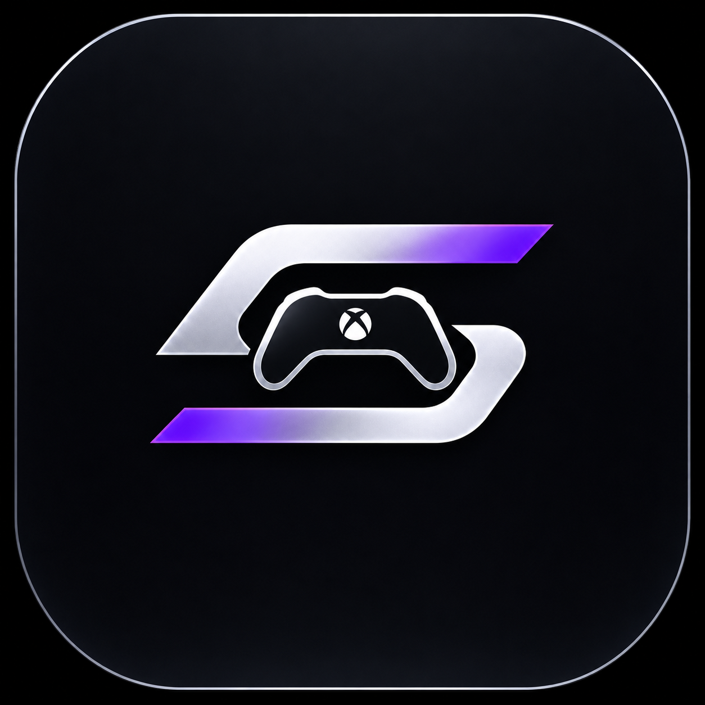

# SkyDek DJ

**Your music. Your controller. Your mix.**

SkyDek DJ is a standalone Windows DJ application by **New Ground Enterprise**. Mix local music with an Xbox controller or your mouse, trigger sound effects, and record your mix in one focused workspace.

**0.10.0 · Windows x64 · Preview**

## Download

**[Download the Windows installer](https://github.com/NewGrndCo/SkyDek-DJ/releases/download/v0.10.0/SkyDek-DJ-0.10.0-Windows-Setup.exe)**

[Get the complete ZIP package](https://github.com/NewGrndCo/SkyDek-DJ/releases/download/v0.10.0/SkyDek-DJ-0.10.0-Windows.zip) · [Release notes](https://github.com/NewGrndCo/SkyDek-DJ/releases/tag/v0.10.0)

Run the installer, then open **SkyDek DJ**. An Xbox controller is optional; pair it with Windows over Bluetooth or connect it by USB. Microsoft WebView2 is required; setup downloads it if missing. **VirtualDJ, loopMIDI and a separate MIDI driver are not required.**

Updating? Stop recording and exit SkyDek through its system-tray menu before running setup. Existing library references and mapping profiles are retained. The preview installer is unsigned; download only from this repository and compare the supplied SHA-256 checksums.

## What you can do

- Mix two decks with level, tempo, filter and crossfader controls.
- Analyze your library for durations and estimated BPM before playback; use **SYNC** to match one deck's tempo to the other.
- Drag waveforms to seek, zoom with the wheel or +/−, and place a main cue and three hot cues.
- Trigger backspin, brake, brake start, echo and reverb. **FX Mix** adjusts effect intensity.
- Arrange sixteen sampler pads with Restart, Toggle, Overlap or Hold playback.
- Record the stereo master as **WAV** or **320 kbps MP3**.
- Save controller mapping profiles, resize the library panels, and switch between dark and light appearance.

## New in 0.10.0

- **MIDI Controllers** in Settings supports USB MIDI Note and absolute CC controls. Select your device, connect, then choose Auto Map. Saved profiles restore on reconnect, and MIDI Learn guides setup for unfamiliar hardware.
- **Deck lighting** shows playback, crossfade balance and track completion. Appearance includes reduced motion and Dark, Light and Xbox skins.
- **Auto DJ** crossfades between imported tracks in the playing track's folder. Set the fade timing in General Settings.
- Settings now uses a sidebar, and the sampler has a compact settings panel.

Hardware support varies by model. HID controls and proprietary jog wheels, LEDs and displays need model-specific support. Physical MIDI devices were unavailable during verification.

## Get started

1. Choose **Import folder** or **Import tracks**. Your music stays in its original location. Use the folder tree and search to browse it.
2. Let **Analyze library** finish; the toolbar shows progress and can pause the scan. General settings offers a full rescan.
3. Load a song using its **1** or **2** button. Use Play to start, and adjust levels and the crossfader.
4. **CUE** previews from the main cue mark. Release before the configured hold time to return and pause; hold until the threshold, then release to keep playing. Use **SET CUE** to move the mark.
5. Open **Sampler settings**, choose your SFX folder, select a sound and assign it to a pad or add it to the next empty pad. Drag assigned pads to rearrange them.
6. Select **WAV** or **MP3** above Record, choose a destination, and stop recording to finalize the file. MP3 support is bundled and runs in the background.

## Xbox quick guide

| Input | Default action |
|---|---|
| D-pad | Browse folders/songs and move between bottom panels; within the sampler, navigate the 4×4 pad grid |
| D-pad left at sampler's first column | Return to the library; Shift+left also changes panels |
| A | Load the selected song into the preparation deck |
| B | Cue preview; hold for the configured duration and release to keep playing |
| X / Y | Load next Sidelist song / add selected song to Sidelist |
| Left stick horizontal / L3 | Crossfader / automatic crossfade |
| Right stick horizontal / vertical | Filter / effect mix |
| R3 | Trigger the selected sampler pad |
| LB / RB | Hold backspin / brake |
| Menu / View | Select target deck / toggle Shift layer |
| Shift+X | Sync target deck tempo to the other deck |

Saved custom mappings take precedence. **Settings → SkyDek Mapper** shows live input and lets you edit and save profiles. The Xbox Share button is reserved by Windows. Center both sticks after reconnecting.

## Sampler modes

| Mode | Behavior |
|---|---|
| Restart | Tap to play through; every press restarts from the beginning |
| Toggle | Press to play, press again to stop |
| Overlap | Each press adds another hit, up to eight simultaneous hits per pad |
| Hold | Plays while held and stops on release |

Names and assignments refer to the original sound files. Keep those files in place. **Stop all samples** silences the bank. Modes save automatically.

## Settings and troubleshooting

General settings includes audio output selection, cue hold time, stick sensitivity and automatic-crossfade duration. Changing output saves the session and restarts the app. **F11** toggles fullscreen; **Space** toggles playback; **C** previews cue. Closing the window keeps SkyDek in the tray; use **Exit** there to quit completely.

- **No sound:** check the chosen output, Windows volume, Master/deck levels and crossfader.
- **Controller not responding:** check live input in Mapper settings, the active profile and Normal/Shift layer. Try USB if Bluetooth is unreliable.
- **Missing sample:** reassign the original file or restore its location.
- **BPM blank or unexpected:** rescan the library. Estimates can be unavailable or half/double tempo. Sync matches tempo, not beat phase; tempo changes also change pitch.
- **Unreadable file:** the MP3 packet-recovery fix handles isolated damaged frames. A web page saved with an MP3 extension is not audio; download the actual audio file.

This preview does not provide stems separation, automatic downbeat/phase sync, pitch-preserving time stretch or separate headphone cueing. Playback loads tracks into memory and currently limits individual loaded tracks to thirty minutes. Test your controller, output, samples and recording before a live set. Report reproducible issues with your app/Windows version; never upload private music or session files.

## About this download

SkyDek DJ application and branding © 2026 New Ground Enterprise. **Proprietary application source is not included.** The separate MP3 utility's complete source, vendored dependencies, build instructions and licenses are supplied under **THIRD-PARTY**. Only that utility's authored source is MIT licensed; dependencies retain their respective licenses. See **SOURCE-CODE-LICENSE.md**, **THIRD-PARTY/NOTICES.txt** and **SHA256SUMS.txt**.

SkyDek DJ is independent and is not affiliated with Microsoft, Xbox or VirtualDJ. No personal music, recordings, credentials or session data is included.
